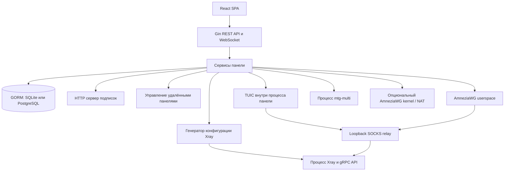

# Этап 1. Аудит и архитектура 3x-ui-fork

Дата: **29 октября 2026**, Asia/Omsk (UTC+6). Статус: проектирование завершено; реализация и deployment не выполнялись.

## 1. Решение и границы доказательств

Новый проект следует строить как **внешний установщик и оркестратор официального 3x-ui**, сохраняя его бинарные файлы, API, модель клиентов, миграции и генераторы подписок. Перенос монолитного установщика с прямой записью SQLite противоречит этой цели. Предлагается небольшой Bash bootstrap и Python-приложение с версионными адаптерами, планом операций, журналом изменений и восстановлением из проверенного снимка.

Исходные деревья получены целиком по зафиксированным commit SHA. Проверены обработчики, сервисы, модели, установочные скрипты, миграции, сборка, генераторы подписок, соответствующие тесты и документация. Все пять shell-скриптов старого форка прочитаны. Это статический аудит перечисленных подсистем, а не доказательство корректности каждой ветви полного upstream. Тестовые файлы upstream изучались как дополнительное свидетельство; его Go-тесты и сетевые подключения клиентов в этом этапе **не запускались**.

На `hl` проведена диагностика по ключу с проверкой host key. Панель там отсутствует, поэтому проверить работающие inbound, подписки и клиентские сессии было невозможно. Не устанавливались пакеты, не запускались скачанные установщики, не менялись конфигурации, firewall и состояния служб. Обычные побочные эффекты SSH-сеанса — журналы входа и учёт соединения — возможны.

| Источник | Зафиксированная ревизия | Основание |
|---|---|---|
| MHSanaei/3x-ui | **v3.11.0**, `c621ba9014a6aa21fd7c9ecf45655e44e24ebf13` | Latest stable и main на момент проверки; release 2026-10-25 |
| XTLS/Xray-core | **v26.10.21**, `1b1647cd9ddf0abc34b981d4611fc03bcac1ca74` | Версия в release workflow панели; исходники core проверены отдельно |
| test-alexsun/3xui-pro-fork | `7e822e3e5dfe6f6e95c57fc83b24d00cd7fde661` | Полный старый установщик и четыре вспомогательных скрипта |
| mozaroc/3x-ui-pro | `a2c430cd6dec7c86d873dcda3544a61e7ac41144` | Исходный установщик, patch, AdGuard, backup, диагностика, шаблоны |
| test-alexsun/3x-ui-fork | Удалённая ревизия не установлена | GitHub API вернул 404; это может означать отсутствие доступа или приватность. Локальный рабочий каталог до отчётов содержал только `.git`, без кода и remote |

Источники: [release панели](https://github.com/MHSanaei/3x-ui/releases/tag/v3.11.0), [исходники панели](https://github.com/MHSanaei/3x-ui/tree/c621ba9014a6aa21fd7c9ecf45655e44e24ebf13), [закрепление Xray при сборке](https://github.com/MHSanaei/3x-ui/blob/c621ba9014a6aa21fd7c9ecf45655e44e24ebf13/.github/workflows/release.yml#L118), [старый форк](https://github.com/test-alexsun/3xui-pro-fork/tree/7e822e3e5dfe6f6e95c57fc83b24d00cd7fde661), [исходный проект](https://github.com/mozaroc/3x-ui-pro/tree/a2c430cd6dec7c86d873dcda3544a61e7ac41144). Публичная главная страница документации показывала более старую версию; при расхождении приоритет отдан закреплённому коду и release metadata.

## 2. Фактическая архитектура официального 3x-ui



### 2.1. Панель, пользователи и состояние

Backend — Go/Gin; GORM поддерживает SQLite и PostgreSQL. Frontend текущей версии — React 19 / Ant Design 6 / Vite, встроенная SPA; предположения о старых Vue-шаблонах неприменимы. Главный процесс запускает HTTP-панель, подписки, фоновые задачи, Xray и управляемые протокольные runtime. См. [main.go](https://github.com/MHSanaei/3x-ui/blob/c621ba9014a6aa21fd7c9ecf45655e44e24ebf13/main.go), [go.mod](https://github.com/MHSanaei/3x-ui/blob/c621ba9014a6aa21fd7c9ecf45655e44e24ebf13/go.mod), [frontend/package.json](https://github.com/MHSanaei/3x-ui/blob/c621ba9014a6aa21fd7c9ecf45655e44e24ebf13/frontend/package.json).

Учётные записи администраторов панели и клиенты прокси — разные сущности. У администратора есть bcrypt-пароль, сессии, TOTP и поддержка LDAP. API token scope ограничивает операции, но не является универсальной моделью изоляции арендаторов: bearer-аутентификация связывается с первым пользователем панели. Не следует создавать собственную схему `user_id=1`. См. [сервис пользователей](https://github.com/MHSanaei/3x-ui/blob/c621ba9014a6aa21fd7c9ecf45655e44e24ebf13/internal/web/service/panel/user.go), [API auth](https://github.com/MHSanaei/3x-ui/blob/c621ba9014a6aa21fd7c9ecf45655e44e24ebf13/internal/web/controller/api.go).

Канонические клиенты находятся в `clients`, связи с inbound — в `client_inbounds`. Вложенные `settings.clients` всё ещё участвуют в представлении inbound, но их одиночное редактирование SQL не обеспечивает согласованности связей, квот, статистики, кэшей и узлов. `email` используется как идентификатор во многих API-маршрутах; изменение красивой подписи не должно менять email. `subId`, UUID, ключи, тарифные лимиты и сроки сохраняются при повторных запусках. Поля времени и трафика адаптер принимает по контракту конкретной версии: имя `totalGB` само по себе не доказывает единицу измерения. См. [модели](https://github.com/MHSanaei/3x-ui/tree/c621ba9014a6aa21fd7c9ecf45655e44e24ebf13/internal/database/model), [клиентский API](https://github.com/MHSanaei/3x-ui/blob/c621ba9014a6aa21fd7c9ecf45655e44e24ebf13/internal/web/controller/client.go).

### 2.2. REST API и OpenAPI

У API нет гарантированного числового namespace `/v1`. База — `/<webBasePath>/panel/api`; формат спецификации **OpenAPI 3.0.3**, `info.version = 3.x`. Нельзя путать номер формата OpenAPI с версией приложения. SHA-256 `frontend/public/openapi.json` в исследованном release: `e26231888ccd904831f1bc3440d6e6faecaf721c4550daaaa2eb24abac58625f`. Панель отдаёт спецификацию через `/panel/api/openapi.json` с учётом base path и авторизации. См. [спецификация](https://github.com/MHSanaei/3x-ui/blob/c621ba9014a6aa21fd7c9ecf45655e44e24ebf13/frontend/public/openapi.json).

| Назначение | Фактические маршруты относительно `/panel/api` | Решение для оркестратора |
|---|---|---|
| Inbound | GET `/inbounds/list`, `/inbounds/get/:id`; POST `/inbounds/add`, `/inbounds/update/:id`, `/inbounds/del/:id` | CRUD только через адаптер; сохранять неизвестные поля |
| Клиенты и связи | GET `/clients/list`, `/clients/get/:email`; POST `/clients/add`, `/clients/update/:email`, `/clients/:email/attach`, `/clients/:email/detach` | Создавать полноценного клиента и связь, а не пустой inbound |
| Hosts и nodes | `/hosts/*`, `/nodes/*` | Использовать собственные API; учитывать groupId и принадлежность узлу |
| Настройки панели | **POST** `/setting/all`, `/setting/update` | Чтение по семантике, частичное изменение по контракту; не стирать замаскированные секреты |
| Xray template | **POST** `/xray/`, `/xray/update` | Сохранять через поддерживаемый сервис; чтение `/xray/` может исправить старую обёртку в БД |
| Состояние | GET `/server/status` | Проверять установленный runtime и версию; `/server/getXrayVersion` возвращает доступные версии |
| Резервирование | GET `/server/getDb`, `/server/getMigration` | Отдельный режим backup: генерация временного файла имеет побочный эффект |
| Восстановление и обновление | POST `/server/importDB`, `/server/installXray/:version`, `/server/updatePanel` | Только изменяющие режимы после проверки версии, снимка и плана |

Источники: [inbound controller](https://github.com/MHSanaei/3x-ui/blob/c621ba9014a6aa21fd7c9ecf45655e44e24ebf13/internal/web/controller/inbound.go), [settings controller](https://github.com/MHSanaei/3x-ui/blob/c621ba9014a6aa21fd7c9ecf45655e44e24ebf13/internal/web/controller/setting.go), [server controller](https://github.com/MHSanaei/3x-ui/blob/c621ba9014a6aa21fd7c9ecf45655e44e24ebf13/internal/web/controller/server.go), [побочный эффект чтения Xray template](https://github.com/MHSanaei/3x-ui/blob/c621ba9014a6aa21fd7c9ecf45655e44e24ebf13/internal/web/controller/xray_setting.go#L76).

Предпочтительна bearer-аутентификация с уже выданным токеном. Поддерживаются `admin`, `monitor`, `node-sync`, `node-admin`; monitor даёт метрики, но **не полный inventory клиентов/inbound**. Для полной диагностики нужны ранее предоставленные достаточные права; скрипт не должен сам их повышать. mTLS проверенной цепочки даёт node-sync, node-admin bearer расширяет права обновления. Cookie-login требует получения `/csrf-token` и `X-CSRF-Token` для небезопасных запросов; bearer проходит отдельный путь. Неверный bearer даёт 401, а анонимный запрос может дать 404. Кроме HTTP-кода нужно разбирать `success`, `msg`, `obj`, ошибки частичного применения и ответ после записи. См. [API auth и scopes](https://github.com/MHSanaei/3x-ui/blob/c621ba9014a6aa21fd7c9ecf45655e44e24ebf13/internal/web/controller/api.go), [middleware](https://github.com/MHSanaei/3x-ui/tree/c621ba9014a6aa21fd7c9ecf45655e44e24ebf13/internal/web/middleware).

Критический CLI-нюанс: `x-ui setting -getApiToken` **создаёт или регенерирует токен с инвалидированием предыдущего**. Его запрещено использовать в `check`, `status`, `dry-run` как «чтение». GET-генераторы ключей также не диагностика. Адаптер нормализует JSON-object и legacy JSON-string для settings/streamSettings; Python int сохраняет 64-битные идентификаторы. Пустой редактируемый секрет и намеренное удаление секрета различаются explicit clear-полями API. См. [CLI](https://github.com/MHSanaei/3x-ui/blob/c621ba9014a6aa21fd7c9ecf45655e44e24ebf13/main.go#L638), [Inbound JSON model](https://github.com/MHSanaei/3x-ui/blob/c621ba9014a6aa21fd7c9ecf45655e44e24ebf13/internal/database/model/model.go).

### 2.3. Xray и дополнительные runtime

Панель генерирует конфигурацию Xray и применяет изменения через его API либо перезапуск, когда hot apply недостаточен. Сохранённая БД и применённый runtime — разные этапы; успех записи не гарантирует работающее соединение. Не надо редактировать сгенерированный `bin/config.json` и удалять `.bak` как якобы «кэш интерфейса». См. [сервис Xray](https://github.com/MHSanaei/3x-ui/blob/c621ba9014a6aa21fd7c9ecf45655e44e24ebf13/internal/web/service/xray.go), [gRPC API](https://github.com/MHSanaei/3x-ui/blob/c621ba9014a6aa21fd7c9ecf45655e44e24ebf13/internal/xray/api.go).

Hysteria2 и MASQUE в этой версии обслуживает сам Xray. TUIC v5 реализован внутри Go-процесса панели; AmneziaWG userspace использует встроенный amneziawg-go/gVisor; оба направляют трафик в Xray через loopback SOCKS relay. MTProto использует отдельный управляемый `mtg-multi`. AmneziaWG kernel — отдельный, явно включаемый режим NAT, обходящий Xray. Поэтому нельзя обещать одинаковые routing/sniffing и экспорт для всех протоколов. Подробности и ограничения — в [матрице совместимости](COMPATIBILITY_MATRIX.md).

### 2.4. Подписки и multi-node

Штатный сервер выдаёт raw/base64, Xray JSON, Clash/Mihomo и HTML-профиль, выбирает формат по UA и явным маршрутам. Native hosts переопределяют внешние адреса/порты/пути. Поддерживаются клиентские routing-профили, в том числе Happ/INCY. Внешний converter из старого mtr-backend не нужен для обычного Clash. Возможность выдать ссылку не равна наличию формата для каждого протокола; MASQUE, например, доступен в JSON, но не в обычной share-link/Clash. См. [сервер подписок](https://github.com/MHSanaei/3x-ui/tree/c621ba9014a6aa21fd7c9ecf45655e44e24ebf13/internal/sub), [документация API подписок](https://github.com/MHSanaei/3x-ui/blob/c621ba9014a6aa21fd7c9ecf45655e44e24ebf13/docs/content/docs/en/reference/api/subscription-server.mdx).

Multi-node — штатная координация самостоятельных панелей с NodeID, panelGuid, bearer/mTLS, heartbeat, синхронизацией клиентов и трафика. Это не кластер над одной общей БД. Версии узлов проверяются отдельно; для новых протоколов есть минимальные version gates. Изменять мастер-данные следует через владельца сущности, не запускать SQL-fix по всем узлам. Транзитивные узлы могут быть доступны лишь для чтения. См. [multi-node](https://github.com/MHSanaei/3x-ui/blob/c621ba9014a6aa21fd7c9ecf45655e44e24ebf13/docs/content/docs/en/operations/multi-node.mdx), [проверка протоколов узлов](https://github.com/MHSanaei/3x-ui/blob/c621ba9014a6aa21fd7c9ecf45655e44e24ebf13/internal/web/service/inbound_protocol.go#L49).

### 2.5. БД, резервирование и миграции

SQLite — штатный вариант по умолчанию; PostgreSQL поддержан через `XUI_DB_TYPE` и `XUI_DB_DSN`, без замены приложения. Путь SQLite задаётся `XUI_DB_FOLDER`. Для systemd на Debian переменные находятся в `/etc/default/x-ui`; другие дистрибутивы используют свои environment files. DSN является секретом. SQLite использует WAL; копирование только живого `x-ui.db` через `cp` не является гарантированно согласованным backup.

При старте выполняются GORM AutoMigrate и специализированные миграции: модели клиентов, индексы, старые протоколы/шифры/поля, исправления трафика. Открытие старой БД новым бинарным файлом уже может её изменить. Откат только бинарного файла недостаточен. См. [database](https://github.com/MHSanaei/3x-ui/tree/c621ba9014a6aa21fd7c9ecf45655e44e24ebf13/internal/database), [DB initialization](https://github.com/MHSanaei/3x-ui/blob/c621ba9014a6aa21fd7c9ecf45655e44e24ebf13/internal/database/db.go).

`getDb` использует штатный SQLite online backup или `pg_dump --format=custom`; PostgreSQL restore выполняется `pg_restore` с очисткой объектов и транзакцией. CLI `migrate-db` умеет `.dump`, восстановление SQLite в **новый** `--out` и SQLite→PostgreSQL. В миграции источник открывается с WAL, schema destination создаётся до транзакции копирования, а sequence reset идёт после неё. Поэтому даже официальный migrate нельзя объявить полностью read-only для источника или полностью атомарным для всего сервера. Мигрировать нужно из копии в отдельную пустую целевую БД. См. [backup/restore service](https://github.com/MHSanaei/3x-ui/blob/c621ba9014a6aa21fd7c9ecf45655e44e24ebf13/internal/web/service/server.go), [migrate-db CLI](https://github.com/MHSanaei/3x-ui/blob/c621ba9014a6aa21fd7c9ecf45655e44e24ebf13/main.go#L598), [план миграции](MIGRATION_PLAN.md).

### 2.6. Официальная установка, обновления и ОС

Официальный install.sh выбирает apt/dnf/yum/pacman/zypper/apk по семейству ОС. Ветви включают Debian/Ubuntu/Armbian, Fedora/RHEL-производные, Arch-производные, openSUSE и Alpine. Это проверка ID семейства, **не сертификация всех выпусков**: строгой таблицы минимальных версий в коде нет. Release workflow собирает amd64, 386, arm64, armv5/v6/v7, s390x; не следует обещать riscv или произвольную Linux ABI. Windows-сборка панели не делает Linux Bash bootstrap переносимым на Windows. См. [installer](https://github.com/MHSanaei/3x-ui/blob/c621ba9014a6aa21fd7c9ecf45655e44e24ebf13/install.sh), [release workflow](https://github.com/MHSanaei/3x-ui/blob/c621ba9014a6aa21fd7c9ecf45655e44e24ebf13/.github/workflows/release.yml).

Для нового проекта предлагается первая тестовая матрица: **Debian 12/13, Ubuntu 24.04/26.04, systemd, amd64**; сначала Debian 13, соответствующий `hl`. Это проектируемая область поддержки, пока не сертификат совместимости. ARM64 — следующая очередь после отдельных тестов. На `hl` переустановка ОС не требуется на основании выявленных данных.

Есть noninteractive-режим, `XUI_PANEL_PORT`, `XUI_WEB_BASE_PATH`, `XUI_USERNAME`, `XUI_PASSWORD`, `XUI_SSL_MODE`, `XUI_DOMAIN`, DB env и возможность отключить автоматическую настройку fail2ban через `XUI_ENABLE_FAIL2BAN=false`. Initial result с секретами сохраняется в `/etc/x-ui/install-result.env`. Поддерживаемого `XUI_LISTEN` не найдено: listenIP задаётся официальным CLI. Нельзя запускать установку с открытым наружу временным администратором и надеяться закрыть порт позднее. Будущая реализация должна до запуска подтвердить изоляцию ingress, сохранить SSH-доступ и после установки выставить loopback через CLI перед снятием изоляции.

Установка проверяет checksum, однако допускает отсутствие sidecar-файла при 404 с предупреждением. Wrapper должен требовать заранее закреплённый digest. Скрипт останавливает службу и удаляет старое дерево перед распаковкой; его временный backup bin не заменяет полноценный снимок. Обновление панели и core — отдельные операции с фиксированными целевыми версиями. Ни install.sh, ни статус update API не являются гарантией rollback всей машины. См. [install.sh](https://github.com/MHSanaei/3x-ui/blob/c621ba9014a6aa21fd7c9ecf45655e44e24ebf13/install.sh), [update.sh](https://github.com/MHSanaei/3x-ui/blob/c621ba9014a6aa21fd7c9ecf45655e44e24ebf13/update.sh).

## 3. Архитектура нового установщика

### 3.1. Границы и структура

Приоритет интеграции: **REST API → официальный CLI → поддерживаемые environment/config → отдельная обоснованная offline-миграция**. Для требуемых повседневных функций необходимости прямой записи в SQLite не найдено. PostgreSQL поддерживается через те же API и отдельный backend резервирования; не через переписывание SQL старого установщика.

Проектируемая структура, ещё не созданная в этом этапе:

```text
bootstrap.sh
pyproject.toml
src/three_x_ui_fork/
  cli.py, models.py, planner.py, executor.py, state.py, secrets.py
  installer.py, preflight.py, compatibility.py, api_client.py
  inbound_manager.py, nginx_manager.py, ssl_manager.py
  subscription_manager.py, routing_manager.py
  backup_manager.py, rollback_manager.py, diagnostics.py
  adapters/panel_v3_11.py
schemas/manifest.schema.json
compatibility/releases.json
templates/nginx/
tests/unit/, tests/contract/, tests/integration/, tests/e2e/
```

Bash проверяет базовые зависимости, скачивает закреплённый Python-пакет с digest, создаёт изолированную среду и передаёт аргументы. В Bash нет SQL, генерации inbound, firewall reset и бизнеса миграции. Никаких `curl .../main/... | bash`, `eval`, передачи паролей в командной строке и незафиксированных pip-зависимостей. Python subprocess запускается списком argv без shell; stdout/stderr проходят редактирование секретов.

| Модуль | Ответственность и контракт |
|---|---|
| installer | Оркестрация закреплённых официальных артефактов, service/env integration; план не выполняется при неизвестной версии или неподтверждённой первичной изоляции |
| preflight | OS/arch/init, CPU/RAM/disk, DNS A/AAAA, владельцы TCP/UDP портов, firewall и SSH, существующая установка, DB tools, права, время, сеть; не чинит систему |
| compatibility | Сопоставляет panel/core/API hash/protocol/runtime/client/OS/DB; выдаёт supported, unsupported или unverified с причиной |
| api_client | Base path, TLS verification, auth/CSRF, envelope, timeout, нормализация JSON, redaction; timeout записи → reconciliation, не слепой повтор POST |
| inbound_manager | Стабильные identity и ownership, клиенты/attach, inbounds/hosts, проверка flow/keys/port; patch только управляемых полей |
| nginx_manager | Собственные include-файлы, явные upstream и paths, staging → nginx -t → атомарная замена файла → reload; существующие vhost сохраняются |
| ssl_manager | Проверка SAN/expiry/chain/key match, ACME challenge по плану, renewal deploy hooks; не убивает процесс на 80/443 и не меняет права на все чужие cert-dir |
| subscription_manager | Штатные настройки/hosts и проверка каждого формата; сохраняет subId и URL, проверяет UA/путь/состав без записи ссылок с секретами в лог |
| routing_manager | Разделяет server Xray routing и client subscription routing; pinned источники, лимиты, схема, digest, last-known-good, API apply |
| backup_manager | Согласованный DB snapshot, конфиги и secret references/необходимые ключи, manifest/checksums, шифрование, retention; обязательная проверка восстановления |
| rollback_manager | Компенсации API/файлов, восстановление согласованной пары binary+DB при миграции, восстановление только принадлежащих проекту ресурсов |
| diagnostics | Санитизированный статус, inventory, health и журнал; сеть/нагрузка/генерация ключей только отдельными явно выбранными проверками |

### 3.2. Manifest, ownership и секреты

Desired manifest содержит schemaVersion, target release tuple, узлы, DB backend без открытого DSN, логические идентификаторы inbound/клиентов, ports, transports, cert references, nginx routes и ссылки на routing-профили. Observed inventory отделён от desired и от state операций.

State планируется хранить в `/var/lib/3x-ui-fork/` с доступом root; конфигурацию и отдельный secret store — в `/etc/3x-ui-fork/` с режимами 0700/0600. В отчётах и plan — только ссылки на секреты. UUID, shortId, пароли, subId, приватные ключи и DSN не попадают в stdout, shell history, exception body и systemd Environment из открытого отчёта. Backup с такими данными шифруется; ключ восстановления должен быть доступен независимо от потерянного сервера.

Панель не обязана поддерживать произвольный custom ownership field. Поэтому отдельный state связывает logical ID → panel/node ID + fingerprint; remark не используется как единственное доказательство владения. Существующие ресурсы принимаются под управление только явным adoption-планом. UUID/ключи генерируются один раз при создании, хранятся до apply, не регенерируются при retry. Смена домена не должна молча менять identity.

### 3.3. План и исполнение

Каждый модуль реализует `discover → validate → plan → apply → verify → compensate`. Plan содержит operation ID, ресурс, зависимости, до/после без секретов, precondition fingerprint, побочные эффекты, требование остановки и обратимость. `flock`/эквивалент блокирует второй экземпляр wrapper; повторное чтение fingerprint перед записью выявляет параллельные правки в GUI. Сам lock не блокирует GUI или другой API-клиент.

Порядок изменяющей операции: inventory → compatibility/preflight → полный план → согласованный backup → durable checkpoint → apply по DAG → runtime/subscription verification → commit state. Journal fsync фиксирует начатую и подтверждённую операцию. При timeout API неизвестный результат проверяется чтением и сравнением identity; нельзя второй раз создать клиента. При частичном успехе состояние обозначается `db_saved_runtime_pending`, а не «успех».

Для файлов допустима атомарная замена в пределах одной FS. Для цепочки API, БД, ACME, пакетов, firewall и Nginx общей транзакции нет; применяются проверяемые компенсации. Если rollback не удался, операция завершается аварийным отчётом с сохранённым backup и последним checkpoint, без удаления диагностических доказательств. Restore после миграции возвращает и DB, и совместимый бинарный файл.

### 3.4. Режимы

| Режим | Поведение | Изменения |
|---|---|---|
| install | Только отсутствующая установка либо явное adoption; выбранный профиль, реальные клиенты, проверка подписки | Пакеты/службы/настройки по плану; никогда предварительное удаление `/etc/x-ui` |
| update | Закреплённая целевая версия, backup, миграции upstream, проверка, rollback | Изменение выбранных компонентов; без смены UUID/subId/админа |
| repair | Только установленный дефект и минимальный diff | Нет auto-reset, нулевых квот взамен invalid и массовой замены клиентов |
| check | Сравнение observed с желаемым и compatibility | Без установки, DB repair, token/key generation, restart и изменения firewall |
| status | Краткое состояние и версии из безопасных источников | Без конфигурационных записей |
| dry-run | Полный план с неопределённостями и символическими будущими секретами | Нет apply, backup, ACME, пакетных установок и скрытых write-endpoints |
| backup | Согласованный снимок и проверка manifest | Создаёт backup/временные файлы; возможная остановка отмечена в плане |
| restore | Выбранный проверенный backup, preview замены, snapshot текущего | Восстанавливает данные и runtime; не сливает БД вслепую |
| rollback | Компенсация конкретной операции/checkpoint | Только известная предыдущая версия и принадлежащие ресурсы |
| uninstall | Удаление принадлежащих wrapper ресурсов по manifest | Данные/backup сохраняются по умолчанию; purge отдельный явно выбранный план |

Read-only означает отсутствие инициированных изменений конфигурации и прикладных данных. Работающая панель и SSH сами могут писать метрики/журналы. Список безопасных операций задаётся по семантике конкретной версии, а не только HTTP-методу. Недостаточные права дают частичный inventory с явным статусом, не выпуск нового admin token.

## 4. Nginx, TLS и сетевой план

Предпочтителен отдельный hostname для панели/подписок с TLS termination в Nginx и loopback upstream. Для WS сохранить Upgrade/Connection, Host и path; для gRPC — HTTP/2 и grpc_pass с правильным serviceName. XHTTP требует проверки режимов, streaming, buffering и таймаутов с выбранным клиентом. TLS в Xray и TLS на Nginx — разные профили, не двойное неявное включение.

REALITY требует сквозного соединения до Xray. Совместное использование TCP/443 возможно через Nginx stream/SNI перед TLS termination на внутреннем loopback-порту; иначе выделенный порт/IP. PROXY protocol включается согласованно на обоих концах. UDP/443 независим от TCP/443, но два QUIC-сервера на одном IP/UDP-порту автоматически не уживаются.

Удаляется универсальный маршрут `/<любое-число>/... → 127.0.0.1:<число>`: разрешены только конкретные upstream. Внутренние порты не слушают wildcard без причины. Real-IP доверяется лишь известному reverse proxy; входные forwarding headers нормализуются. Cookie Secure/HttpOnly/SameSite проверяются за TLS termination; прямое loopback HTTP требует корректной настройки secure cookies на proxy, а HTTPS upstream — проверки сертификата. Не маскировать все 401/403/5xx под 404: это ломает диагностику API.

Firewall меняется только явно запрошенным networking-планом, с сохранением фактического SSH-порта, IPv4/IPv6, established-соединений и чужих правил. Управление ограничено собственными таблицами/цепочками или поддерживаемым frontend; `ufw disable`, глобальный flush и `fuser -k` исключены. SSH-резервный путь и проверка внешнего доступа обязательны до публикации. Nginx/ACME необходимы лишь выбранным профилям, AdGuard, speedtest, mtr и системный BBR не являются обязательной частью установки.

## 5. Приоритеты, риски и проверка результата

Первая версия: inventory/plan и API adapter → backup/restore → один полностью проверенный VLESS REALITY Vision → TLS/WS/gRPC и штатные подписки → остальные протоколы → обновление/rollback → multi-node и PostgreSQL migration. Включать сразу шестнадцать пустых inbound нельзя: число строк не измеряет работоспособность.

Основные риски: дрейф API 3.x, миграция БД при старте, частичный hot apply, утрата клиентских identity, чужие Nginx/firewall, неизвестная версия клиента/MTProto sidecar, отличие userspace/kernel AWG, downgrade после schema migration. Для каждого нужен отрицательный тест и проверяемый путь восстановления.

Критерии приёмки: второй идентичный запуск даёт нулевой diff; timeout/retry не создаёт дублей; чужие ресурсы сохраняются; check/status/dry-run не пишут конфигурацию; backup реально восстанавливается на SQLite и PostgreSQL; все заявленные протоколы проходят handshake, трафик, лимиты, отключение и соответствующий экспорт; падение в каждой фазе update возвращает согласованное состояние. Подробные этапы и test gates — [MIGRATION_PLAN.md](MIGRATION_PLAN.md), разбор старых функций — [FEATURE_MATRIX.md](FEATURE_MATRIX.md), факты о сервере — [HL_BASELINE.md](HL_BASELINE.md).

На этом этапе созданы только пять отчётов. Реализация, коммиты/push, установка и изменения на `hl` не выполнялись. Следующий этап предназначен для Sol 6.1 Max по отдельному заданию пользователя.
